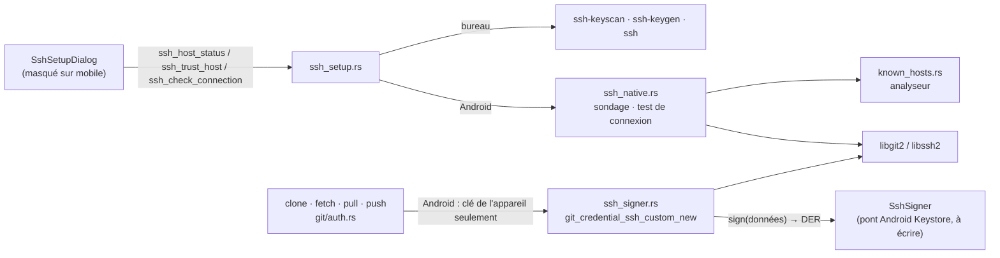
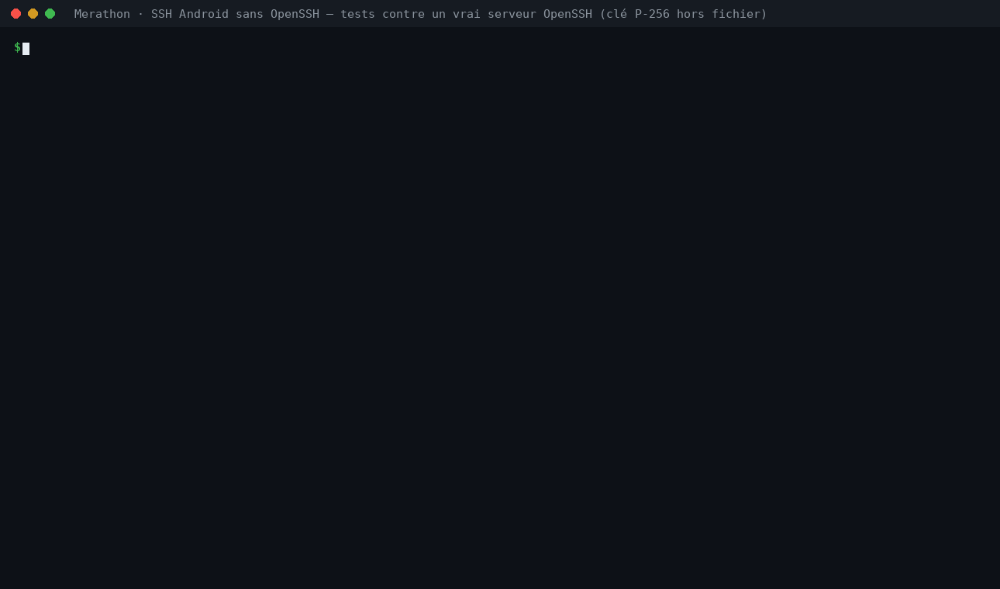
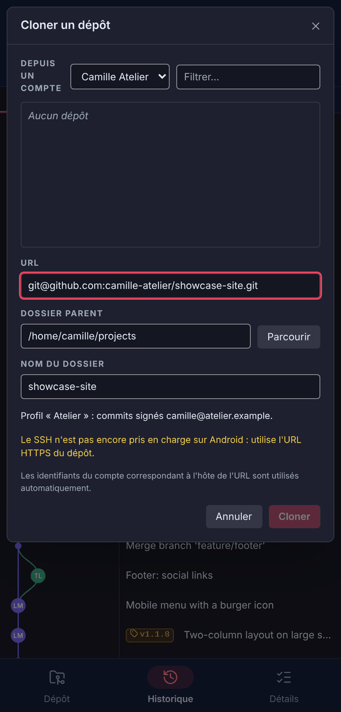
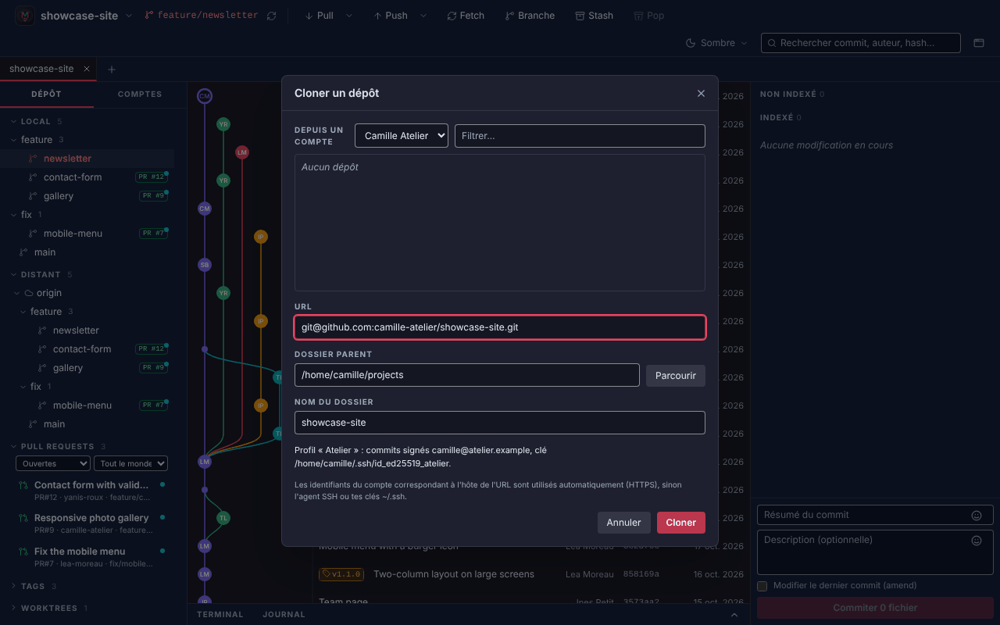
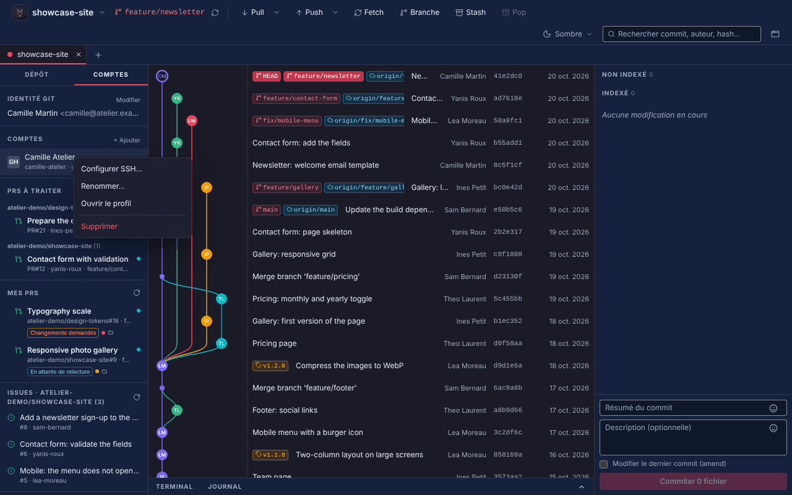
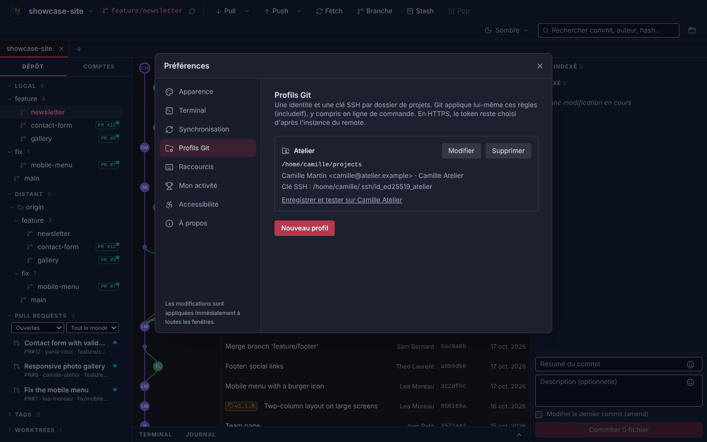

# SSH sur Android sans OpenSSH (issue #38)

État au 5 novembre 2026 : **les briques Rust sont prêtes et validées contre un vrai serveur OpenSSH ; le SSH reste désactivé sur Android** tant que le pont Android Keystore n'a pas été écrit et validé sur un appareil (étape 1 de l'issue, « prototype sur l'émulateur, puis sur un vrai téléphone »).

Rien ne change sur Windows ni sur Linux : le bureau garde OpenSSH (`ssh-keyscan`, `ssh-keygen`, `ssh`), comme avant.

## Pourquoi le SSH échouait sur Android

libgit2 et libssh2 sont embarqués, mais `ssh_setup.rs` s'appuyait sur trois programmes d'OpenSSH absents d'Android :

| Fonction | Programme | Remplacé sur Android par |
|---|---|---|
| `scan()` (clé du serveur) | `ssh-keyscan` | `ssh_native::probe` : connexion libgit2, clé lue dans `certificate_check`, coupure avant toute authentification |
| `is_known()` | `ssh-keygen -F` | `known_hosts::is_known` / `known_hosts::lookup` (analyseur Rust) |
| `check_connection()` | `ssh -T` | `ssh_native::check_connection` : authentification libgit2 vers un dépôt inexistant |

Sans `known_hosts` rempli, libgit2 refuse la connexion avant même l'authentification (`invalid or unknown remote ssh hostkey`).

## Architecture



### Fichiers

| Fichier | Rôle | Compilé |
|---|---|---|
| `src-tauri/src/known_hosts.rs` | Lecture de `known_hosts` : hôtes en clair, listes, `[hôte]:port`, `*` `?` `!`, commentaires, `@revoked`. Les lignes hachées (`\|1\|…`) et `@cert-authority` sont ignorées (voir plus bas). | Android + tests |
| `src-tauri/src/ssh_native.rs` | Sondage de la clé du serveur, statut et validation de l'hôte, test de connexion, délais maximaux. | Android + tests |
| `src-tauri/src/ssh_signer.rs` | Piste 1 : clé qui ne sort jamais du coffre. FFI vers `git_credential_ssh_custom_new`, conversion de la signature DER au format SSH, enregistrement de la clé de l'appareil. | Android + tests |
| `src-tauri/src/test_sshd.rs` | Serveur OpenSSH jetable pour les tests (port libre, clés d'hôte et `authorized_keys` propres, `HOME` isolé). | tests |
| `src-tauri/src/ssh_setup.rs` | Branches `cfg(target_os = "android")` vers `ssh_native` ; le code du bureau est inchangé. Création de clé refusée sur Android. | partout |
| `src-tauri/src/git/auth.rs` | `SshSources` : bureau = agent + clés `~/.ssh` + clé du profil (inchangé) ; Android = clé de l'appareil seulement, ni agent ni fichier. | partout |

Sur le bureau, `known_hosts.rs`, `ssh_native.rs` et `ssh_signer.rs` ne sont compilés que pour les tests : le binaire livré sous Windows et Linux ne contient pas ce code. Aucune crate n'est ajoutée à `Cargo.lock` (`base64ct`, `libc`, `ring` et `libgit2-sys` y étaient déjà).

## Choix techniques

### Piste 1 retenue côté Rust : la clé signe, elle ne se lit pas

`git2` n'expose pas `git_credential_ssh_custom_new` ; `ssh_signer.rs` le déclare lui-même, car le type du rappel dans `libgit2-sys` oublie sa valeur de retour (`int`), que libssh2 lit pour savoir si la signature a réussi. La signature est allouée avec `malloc` (libssh2 la libère avec `free`) et aucune panique ne traverse le code C.

**Algorithme : ECDSA P-256** (`ecdsa-sha2-nistp256`). C'est le seul que l'Android Keystore propose sur toutes les versions prises en charge (`minSdk = 24` ; Ed25519 n'y arrive qu'avec Android 13). GitHub, GitLab et OpenSSH l'acceptent. Le Keystore signe en `SHA256withECDSA` et rend une signature DER : elle est convertie en `mpint r, mpint s`, ce qu'attend libssh2.

Le pont Kotlin n'aura donc qu'à fournir deux choses :

```rust
pub trait SshSigner: Send + Sync {
    /// Point public P-256 non compressé (65 octets) ; `point_from_spki` le lit dans `PublicKey.getEncoded()`.
    fn public_point(&self) -> Vec<u8>;
    /// Signature SHA256withECDSA (DER) ; peut attendre la confirmation de l'utilisateur.
    fn sign(&self, data: &[u8]) -> Result<Vec<u8>, String>;
}
```

puis appeler `ssh_signer::set_device_signer(Some(…))`. `public_key_openssh` donne la ligne à ajouter sur la forge.

### Une confirmation par opération, jamais pour une clé inconnue du serveur

libssh2 demande d'abord au serveur si la clé est acceptée, sans signer. Une clé qui n'est pas sur la forge ne déclenche donc **aucune** confirmation (vérifié dans les tests). Une opération Git = une connexion = une signature.

### Vérification de l'hôte

- Le sondage ne propose aucune clé de l'utilisateur et coupe la connexion dès la clé du serveur reçue.
- Sans entrée dans `known_hosts`, libssh2 négocie **ECDSA** en premier (et non ed25519 comme `ssh-keyscan -t ed25519` sur le bureau). `PUBLISHED_FINGERPRINTS` contient donc les trois types publiés par GitHub et GitLab (ed25519, ECDSA, RSA). Un type non publié par ces forges est refusé, comme une empreinte différente.
- `trust_host` interroge à nouveau le serveur : seule l'empreinte validée par l'utilisateur est écrite, au format `[hôte]:port` hors port 22, et jamais par-dessus une clé déjà enregistrée.
- Clé d'hôte modifiée ou révoquée : connexion bloquée avant toute signature, sans proposer d'accepter la nouvelle clé.
- Pour un test de connexion, la vérification est double : celle de `known_hosts.rs`, puis celle de libssh2.
- Lignes hachées ignorées : sur Android, seul Merathon écrit ce fichier, toujours en clair. Une telle ligne fait traiter l'hôte comme inconnu (validation de l'empreinte), jamais comme accepté.

### Délais

Sondage : 8 s (comme `ssh-keyscan -T 8`). Test de connexion : 60 s, pour laisser le temps de confirmer. Au-delà, l'opération s'arrête et le fil abandonné ne demande plus aucune confirmation.

## Ce qui a été vérifié, et comment

Tous les tests tournent sur Linux contre **un vrai `sshd` OpenSSH** lancé par le test, avec une clé P-256 logicielle (`ring`) qui a la même interface et le même format DER que le Keystore :



| Vérification | Test |
|---|---|
| Hôte inconnu : clone refusé avant toute signature | `git::auth::tests::clone_fetch_pull_and_push_over_ssh_with_the_device_key` |
| Empreinte lue par libgit2 = celle du serveur ; empreinte erronée refusée, rien d'écrit | `ssh_native::tests::setup_flow_against_a_real_openssh_server` |
| Après écriture de `known_hosts`, libgit2 passe l'étape de l'hôte | les deux tests ci-dessus |
| Clone, push, second clone, fetch + pull en SSH avec la clé de l'appareil | `clone_fetch_pull_and_push_over_ssh_with_the_device_key` |
| Authentification ECDSA réelle (`Accepted publickey … ECDSA` dans le journal de sshd) | `MERATHON_SSHD_LOG=1` |
| Confirmation refusée : opération arrêtée, message clair, serveur et dépôt local inchangés | les deux tests |
| Clé absente de la forge : refus clair, aucune signature | les deux tests |
| Clé d'hôte modifiée : connexion bloquée, rien proposé, `known_hosts` intact | `setup_flow_against_a_real_openssh_server` |
| Port muet (réseau coupé) : abandon après le délai | `probe_gives_up_after_the_timeout` |
| Aucune clé privée sur le disque (`~/.ssh` ne contient que `known_hosts`) | `clone_fetch_pull_and_push_over_ssh_with_the_device_key` |
| Signatures converties toujours valides (200 tirages), DER malformés refusés | `ssh_signer::tests` |
| Formats de `known_hosts` | `known_hosts::tests` |
| Bureau : liste des candidats d'authentification inchangée | `git::auth::tests` |
| Garde-fous mobiles (clone, comptes, profils Git) et bureau inchangé | `src/components/AndroidSshGuards.test.tsx` |

```bash
cd git-client/src-tauri
MERATHON_REQUIRE_SSHD=1 cargo test                       # échoue si sshd est introuvable (CI Linux)
MERATHON_SSH_DEMO=1 MERATHON_SSHD_LOG=1 cargo test -- \
  ssh_native::tests::setup_flow git::auth::tests::clone --nocapture   # récit étape par étape + journal de sshd
```

Sans `sshd` (Windows, poste sans OpenSSH), ces tests sont passés avec un message. La CI Linux installe `openssh-server` et pose `MERATHON_REQUIRE_SSHD=1`. Les tests de bout en bout tournent dans un processus enfant dont `HOME` est un dossier temporaire : libgit2 lit `~/.ssh/known_hosts` à partir de `HOME`, une fois par processus, et le `~/.ssh` du poste n'est jamais touché.

**Compilation Android** : la cible `aarch64-linux-android` et le NDK n'étaient pas disponibles dans l'environnement de travail. Les branches `cfg(target_os = "android")` ont été vérifiées par `cargo clippy --lib -- -D warnings --cfg 'target_os="android"'` sur une copie du projet (avec les dépendances Android ajoutées) : aucune erreur ni avertissement. Ce n'est pas une vraie compilation croisée : `cargo tauri android build` reste à lancer.

## Garde-fous conservés sur mobile

Tant que le pont Keystore n'est pas validé, le SSH reste masqué sur Android (étape 8 de l'issue non réalisée, comme elle le demande). Cette PR les complète :

| Android | Bureau (inchangé) |
|---|---|
|  |  |
|  |  |
|  |  |

- Clone : URL SSH bloquée, y compris `git+ssh://` et `ssh+git://` ; plus d'exemple d'URL SSH ni de clé du profil affichée.
- Comptes : pas de « Configurer SSH… » (inchangé).
- Profils Git : ni choix de clé (inchangé), ni ligne « Clé SSH : clés par défaut », ni bouton « Enregistrer et tester » ; le texte d'aide ne parle plus de clé SSH.
- Backend : `ssh_create_key` refuse d'écrire une clé sur Android ; l'authentification n'utilise jamais de fichier de clé ni d'agent ; un remote SSH ajouté à la main échoue avec « Le SSH n'est pas encore pris en charge sur Android : utilise l'URL HTTPS du dépôt ».

## Reste à faire sur un appareil

### 1. Pont Android Keystore (Kotlin, `MainActivity` ou plugin Tauri)

- Dépendance `androidx.biometric:biometric` (Android uniquement).
- Création : `KeyPairGenerator.getInstance(KEY_ALGORITHM_EC, "AndroidKeyStore")` avec `KeyGenParameterSpec.Builder(alias, PURPOSE_SIGN).setAlgorithmParameterSpec(ECGenParameterSpec("secp256r1")).setDigests(DIGEST_SHA256).setUserAuthenticationRequired(true)`, puis `setInvalidatedByBiometricEnrollment(true)`.
- Validité de la confirmation :
  - API ≥ 30 : `setUserAuthenticationParameters(durée, AUTH_BIOMETRIC_STRONG or AUTH_DEVICE_CREDENTIAL)`.
  - API 24 à 29 : `setUserAuthenticationValidityDurationSeconds(durée)`, avec `BiometricPrompt` (ou `KeyguardManager.createConfirmDeviceCredentialIntent`) avant la signature. Le repli sur le code de l'appareil avec un `CryptoObject` n'existe qu'à partir de l'API 30 : une durée > 0 est donc nécessaire avant.
  - Une durée de quelques dizaines de secondes couvre un enchaînement (fetch puis push) sans redemander.
- Signature : `Signature.getInstance("SHA256withECDSA")`, `initSign`, `update(data)`, `sign()` → DER, rendu à Rust.
- Rust ↔ Kotlin : `sign()` est appelé dans un fil de travail de libgit2, jamais celui de l'interface. Le pont affiche `BiometricPrompt` sur le fil principal et bloque ce fil de travail (par exemple avec un `CountDownLatch`) jusqu'à la réponse : l'interface ne se fige pas.
- Cas à traiter : pas de verrouillage d'écran (`KeyguardManager.isDeviceSecure`) → expliquer qu'il en faut un, sans repli ; `KeyPermanentlyInvalidatedException` → proposer une nouvelle clé, à ajouter sur la forge ; confirmation annulée → message rendu par `sign()` (déjà affiché tel quel).

### 2. Interface et synchronisation

- Retirer les garde-fous (étape 8 de l'issue), une fois le pont validé.
- Parcours `SshSetupDialog` sur petit écran : création de la clé dans le Keystore (sans passphrase), copie de la clé publique, validation de l'hôte, test de connexion. Le nom de machine par défaut vaut déjà « ce téléphone ».
- `lib/autoSync.ts` : aucune confirmation en arrière-plan. Ignorer sans bruit les dépôts SSH quand la clé est verrouillée et le signaler dans l'état de synchronisation.
- Mémo Git : rubrique sur les clés SSH.

### 3. Vérifications sur émulateur puis sur un vrai téléphone arm64

- Clone, fetch, pull et push en SSH sur GitHub et GitLab (`certificate_check` fournit-il `hostkey()` ? empreinte ECDSA = `PUBLISHED_FINGERPRINTS` ?).
- Test de connexion réel : clé refusée → refus clair ; clé acceptée → « dépôt introuvable » compté comme un succès.
- Instance auto-hébergée : validation manuelle de l'empreinte.
- Clé d'hôte modifiée, appareil sans verrouillage, clé invalidée après ajout d'une empreinte.
- Avec `adb shell run-as com.gitclient.app`, lister le `.ssh` du dossier de données de l'application (le `HOME` posé par `device_storage::set_home`) : aucune clé privée, seulement `known_hosts`.
- Réseau coupé, sous-modules et worktrees d'un dépôt cloné en SSH.
- Après un build Android : `git restore git-client/src-tauri/gen/schemas/acl-manifests.json` avant de commiter.
